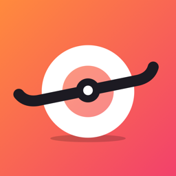

<p align="center"></p>

# unowheel

An iOS app for the Onewheel. It unlocks the board over Bluetooth on its own, shows live ride data, and puts your battery on the home screen, the lock screen and the Dynamic Island.

The canonical repo for this is hosted on tangled over at [`https://tangled.org/dunkirk.sh/unowheel`](https://tangled.org/dunkirk.sh/unowheel)

## Layout

| Path | What it is |
| --- | --- |
| `OnewheelKit/` | Swift package with the protocol: GATT map, telemetry decoding, the handshake, and a PacketLogger `.pklg` reader. No UI. |
| `ios/` | The app and its widget extension. `project.yml` is the source of truth; the Xcode project is generated from it. |
| `tools/icon.swift` | Draws the app icon (light, dark and tinted). Run `swift tools/icon.swift` from the repo root. |
| `tools/ow_unlock.py` | Python and bleak probe for poking a board from a Mac. |
| `tools/ow_activate.py` | Fetches a board's unlock response from Future Motion, stdlib only. |
| `docs/protocol.md` | Protocol notes: what was measured, what was decompiled, and what is still unknown. |

## Building

```sh
cd OnewheelKit && swift test          # protocol tests, including the real capture if it's in ~/Downloads
cd ios && xcodegen generate           # after editing project.yml
open ios/UnoWheel.xcodeproj           # run on a real phone; the simulator has no Bluetooth
```

## Unlocking a board

Boards on firmware 4141 and up, which includes every Pint, only accept a response that Future Motion's server issues once per board. The board's challenge never changes, so you only need that response once.

UnoWheel gets it the way the official Android app does: it sends the challenge to Future Motion, and the answer comes back as a push notification. UnoWheel registers for those pushes as the Android app and listens on Google's push socket while it waits, so this needs an internet connection the first time and no account. The response goes in the Keychain and the board unlocks by itself from then on. See `docs/protocol.md`, "Fetching the response".

If that fails, you can still bring the response yourself: record the official app connecting with the iOS Bluetooth logging profile and PacketLogger, then choose **Import capture** in UnoWheel, or paste the 40 hex characters.

## Riding

- **Automatic connection:** there is no connect button. UnoWheel keeps a standing request with iOS for every board you've added, so whichever one turns on gets picked up, even from your pocket. Pick a board from the title menu to switch while two are on. While disconnected, the app shows each board's last known stats.
- **Board health:** a fault banner if the board flags one, a charging state, and a battery card with health, charge cycles, cell type and battery ID (read from the board's diagnostic stream).
- **Range:** "x mi left" on the dashboard, the widgets and the lock screen. It starts from Future Motion's rated range, then learns how many watt-hours per mile you use (power x time over distance, regen counted at a quarter) and estimates from the energy left in the pack. What it has learned is kept per board.

## Widgets

- **Board battery:** small and medium home screen widgets, plus circular, rectangular and inline lock screen widgets. They show the last values the app saw, including range.
- **Ride Live Activity:** on the lock screen and in the Dynamic Island. Shows ride state (riding, regen, stopped), speed, battery bar, range, ride time, trip, top speed and mode. iOS only lets apps start Live Activities from the foreground, so after a background auto-connect it appears next time you open UnoWheel.

The app and the widgets share data through the `group.sh.dunkirk.unowheel` App Group.

<p align="center">
    
</p>

<p align="center">
    <i><code>&copy; 2026-present <a href="https://dunkirk.sh">Kieran Klukas</a></code></i>
</p>

<p align="center">
    <a href="https://tangled.org/dunkirk.sh/unowheel/blob/main/LICENSE.md"></a>
</p>
